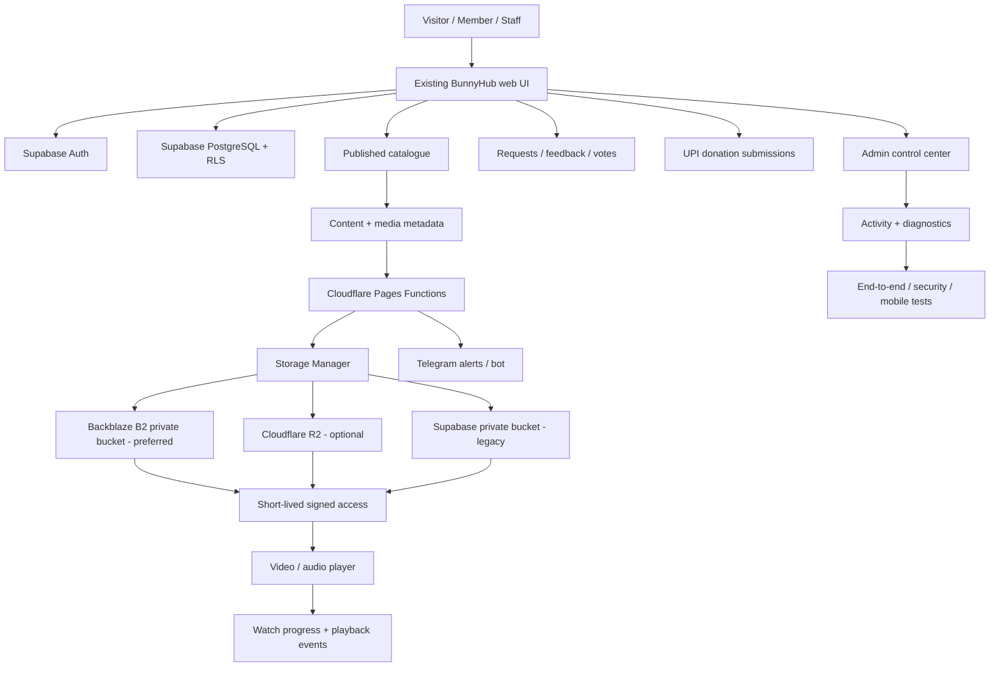
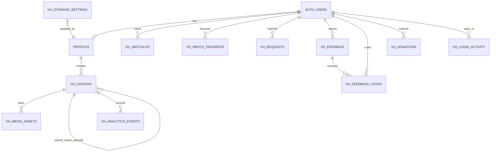

# BunnyHub — Completion Roadmap & Verification Plan
> **Current-state notice (21 Nov 2026):** this roadmap was an earlier planning snapshot. Its Supabase connector-mismatch and pre-migration statements are historical and no longer current. Use [BunnyHub Current Production Status](bunnyhub-CURRENT-STATUS.md) for the verified live schema, upload root causes/fixes, deployment, current blockers and test evidence.

**Purpose:** finish the existing BunnyHub application without replacing its approved layout, while preserving existing database rows, media objects, user accounts and RLS.

## 1. Verified production baseline (21 Nov 2026)

| Check | Observed result | Interpretation |
|---|---|---|
| Cloudflare Pages | `bunnyhub` project, GitHub `main`, automatic production deployment | Connected and deploying |
| Latest production deployment | `5033bee0`, commit `4e876729`, build and deploy stages succeeded at 2026-11-20 22:50:58 UTC (2026-11-21 04:20:58 IST) | Profile compatibility fixes and recovery docs are live in Pages Production; this is not a browser/E2E pass |
| Pages Function `/api/media/status` | Supabase client + service-role configured; Backblaze B2 configured; R2 and PixelDrain not configured | B2 and Supabase server variables are present; this endpoint does not prove a real object upload works |
| Public homepage | Renders without maintenance overlay; catalogue sections show empty states | UI is present; published catalogue is empty |
| Main homepage rails | Trending, catalogue, series, latest, top-rated, shorts and genres render | Needs lawful sample records |
| GitHub Actions | `Validate BunnyHub` run #463 succeeded for commit `068f19e1` | Existing JS syntax and SQL-structure checks passed |
| Real upload / playback | Not yet tested end-to-end | Must verify with a signed-in admin and a small authorised media file |
| Supabase schema state | Not verified against the production database | Both frontend `js/supabase-config.js` and Pages `SUPABASE_URL` point to `bmtbsguwbbeuvmvdfdyb`. The connected Supabase integration exposes only `rcpofawscmxtayrvuqzn`. User-provided SQL inventory lists only legacy public tables (`movies`, `profiles`, `requests`, `watchlist`) and no `vh_*` tables, despite an earlier publish constraint error referencing `vh_content`. Treat this as a project/schema mismatch until the SQL Editor project ref is reconciled. Do not run migrations against the mismatched connector project. |

## 2. Target architecture

## 3. Data model and lifecycle

**Rules:** catalog metadata lives in SQL; large video/audio bytes live in private object storage; the database stores provider, object path, content relation and technical metadata. Playback and download URLs are short-lived and only issued after checking published content and its linked media asset. Never put provider secrets in browser code or SQL rows.

## 4. Ordered implementation phases

| Phase | Work package | Required output / exit gate |
|---|---|---|
| 0 — Baseline & access | Confirm exact production Supabase project access, backup state, current migration history, Pages bindings and deployment | Correct project identity verified; no production mutation until target is certain |
| 1 — Schema & security | Compare existing tables, constraints, functions, triggers, grants and RLS against the migration bundle; reconcile only missing additive migrations | Schema diff and RLS/advisor report; existing records preserved |
| 2 — Storage | Validate B2 bucket privacy, exact-origin CORS, signing, upload, object HEAD/read, playback, attachment download and deletion; retain Supabase legacy support; test R2 only if credentials are intentionally configured | One small test object completes upload → metadata link → signed read → playback → delete; no orphan rows/objects |
| 3 — Legal demo content | Prepare an attributed, rights-checked seed pack for Movie, Web Series + Episodes, Shows/Documentary, Shorts and Songs; add posters, descriptions, language, genre, year and playback source; keep test content clearly labelled | All rails populated with lawful demo content; every media source passes a rights and reachability check |
| 4 — Core workflows | Verify admin CRUD, editor ownership, series/episode grouping, music library, search/filter/sort, watchlist, resume, requests, community moderation/voting, settings and donation flow | Each workflow passes positive and negative permission tests |
| 5 — Integrations | Verify Telegram webhook and notifications; Google Drive public-file import; keep unsupported providers visibly marked as link-only / setup-required; AdSense remains disabled until approval and consent setup | Each integration has a truthful connected / missing-credential status |
| 6 — Observability | Verify login activity, first-party analytics, upload/playback errors, admin audit trail and privacy boundaries | Useful logs without storing passwords, payment secrets, or unnecessary personal data |
| 7 — Final QA & launch | Desktop/mobile, accessibility, performance, SEO, browser console/network, RLS/IDOR, upload limits, player quality/subtitles/progress/download, backup/restore plan | Signed-off test report with pass/fail/blocker for every item |

## 5. Feature checklist

### Catalogue and playback
- [ ] Movies, Web Series, Shows/Documentaries, Seasons/Episodes, Shorts and Songs each contain test records.
- [ ] Search covers title and available metadata; filters, sort, latest, popular and genre rails are correct.
- [ ] Movie details remain a popup over the existing home layout; download options appear only on request.
- [ ] Player is opened only by Watch Now; player minimise and movie-details minimise remain independent.
- [ ] Verify play, pause, seek, volume, fullscreen, quality, subtitles, resume position, next episode and signed downloads.
- [ ] Verify empty-state behaviour after removing only test fixtures.

### Storage and media safety
- [ ] Confirm B2 exact bucket name, endpoint, key scope and exact-origin CORS; do not reveal secrets.
- [ ] Verify upload URL role checks and content-type / size limits.
- [ ] Verify storage path ownership, content-to-asset association, signed access expiry and deletion authorisation.
- [ ] Confirm no public bucket exposure and no deletion of legacy Supabase/R2 media.
- [ ] Multipart/resumable uploads above the current 5 GB video single-PUT limit are not implemented yet.
- [ ] Audio upload limit currently coded as 1 GB; verify actual provider limits before enabling large uploads.

### Accounts, admin and privacy
- [ ] Registration, email confirmation, login, logout, password reset and session expiry.
- [ ] Admin, sub-admin, content-editor and moderator capability boundaries.
- [ ] Login activity migration and main-admin-only visibility.
- [ ] Show safe account activity only; never display or store plaintext passwords.
- [ ] Confirm guest requests cannot expose requester identity and public APIs expose only approved columns.

### External integrations
- [ ] Telegram bot token, webhook secret, admin chat and optional channel setup.
- [ ] Google Drive API key restricted to Drive API; test a single public shared file.
- [ ] TeraBox/Drive OAuth upload, Telegram file uploads and other providers remain unimplemented until official credentials and tested connectors exist.
- [ ] UPI amount boundary must be consistently ₹1–₹999 in UI and database; verify current SQL constraint before release.
- [ ] AdSense only after publisher approval, slot configuration and required consent management.

## 6. Lawful test-content policy

Use original test assets, public-domain works, or Creative Commons assets whose exact license permits the intended use. Keep attribution and source/license URLs with each seed record. Do not populate the live catalogue with commercial copyrighted films, scraped piracy links, or files whose distribution rights are unclear. Prefer a short original generated test video and audio clip for upload/player smoke tests; use licensed sample films only for catalogue and streaming coverage.

Suggested minimum test dataset:
- 2 Movies (one direct B2 upload, one authorised external source)
- 1 Web Series, 1 Season, 2 Episodes
- 1 Documentary/Show
- 2 Shorts
- 2 Songs (original or public-domain recording)
- 1 poster/thumbnail set, 1 subtitle file, multiple quality variants where genuinely available
- 1 unpublished draft to test public/private visibility

## 7. Test matrix and evidence

| Test layer | Cases | Evidence |
|---|---|---|
| Static / CI | JS syntax, SQL structure, migration formatting | GitHub Actions run |
| API | status, unauthenticated rejection, role checks, malformed input, limits | HTTP status + redacted response |
| Database | migrations, RLS, grants, constraints, foreign keys, rollback safety | migration history + read-only queries + advisors |
| Storage | PUT, HEAD/GET, signed URL, expiry, deletion, orphan cleanup | provider result + DB asset row |
| Player | movie, episode, short, song; seek/quality/subtitles/progress/download | browser run + network results |
| User flows | signup, email, login, watchlist, requests, feedback, donation | test account actions |
| Admin flows | publish/unpublish, edit, delete test item, staff permissions, logs | role-by-role evidence |
| UI | PC sidebar, mobile bottom dock, popup/player independence, themes | desktop + phone viewport screenshots |
| Security | RLS, IDOR, role bypass, secret exposure, private bucket access | negative test results |
| Performance | Lighthouse, large poster lazy loading, player startup, mobile layout | measured scores and timings |

## 8. Known blockers and guardrails

1. **Supabase connection mismatch:** website config points to `bmtbsguwbbeuvmvdfdyb`; the available Supabase connector currently lists only `rcpofawscmxtayrvuqzn`. No SQL migration or database write is safe until access to the exact production project is available.
2. **B2:** live status confirms the required server variables are present, but browser CORS and an actual signed upload/playback/delete cycle still need verification.
3. **No published content:** live homepage sections are rendering correctly but currently empty. The seed pack must use authorised media and be labelled as demo/test content.
4. **SMTP:** production signup previously showed a confirmation-mail failure. SMTP delivery must be verified before signup can be signed off.
5. **Telegram / Google / AdSense:** external credentials and approvals are separate setup gates; code presence is not proof of a connected integration.
6. **UI safety:** preserve the approved homepage, popup details, desktop left sidebar and mobile bottom dock. Any major redesign requires a preview and explicit approval first.

**Completion definition:** every checklist item is marked PASS, FAIL (with fix), or BLOCKED (with the exact external dependency). Do not call the platform complete while a critical storage, auth, RLS, playback or mobile test remains unverified.

## 10. Production schema recovery notes (21 Nov 2026)

The legacy `profiles` table currently reports `id`, `full_name`, `role` and `created_at`. Current application code historically expected `fullname`. A compatibility patch now reads/writes either spelling, and the Master Setup migration backfills `fullname` from `full_name` where needed without deleting the legacy column.

For a partial database that contains legacy tables but no `vh_*` tables, the setup order is documented in `README-SETUP.txt`: verify the owner Auth UUID, run Master Setup, run the platform upgrade, then the feature-upgrade bundle, followed only by missing watchlist/progress/request migrations. This order must be executed only against the confirmed Production Supabase ref. No schema migration has been executed through the currently connected Supabase integration because it exposes a different project.

## 9. Security activity and Admin-session hardening (20 Nov 2026)

The following work was added without replacing the approved public layout:

- The public member menu no longer exposes a Control Center link. Admin/staff sessions are not shown the public U/A avatar menu; the Secure Admin panel remains the only supported Admin sign-in path.
- User Login rejects staff roles. A legacy staff session without a secret-panel session marker is signed out.
- Production Cloudflare Pages now has a D1 security database named `bunnyhub-security`, bound as `VH_SECURITY_DB`; the table/index definition is versioned at `cloudflare/d1-security-schema.sql`.
- The Pages secret `VH_ADMIN_SESSION_SECRET` signs a one-hour HttpOnly, Secure, SameSite=Strict cookie. Every staff-protected Pages Function checks the Supabase role and this cookie.
- Five failed Admin sign-in or unauthorised staff/API attempts from one source IP in a rolling 30-minute window cause a 30-minute temporary block.
- Security events include guest visits, authenticated visits, user sign-in/signup/logout, Admin attempts, blocked attempts and protected-area access. IP is read from Cloudflare's server-provided `CF-Connecting-IP` header.
- Raw IP/user-agent records are retained for up to 90 days. Only `profiles.role = 'admin'` can read the activity API; staff roles cannot.
- Privacy Policy now discloses the security activity fields and retention.

**Verification gate:** the D1 database, schema, Production binding and secret are provisioned. The latest code still requires its Production deployment and live checks for: cookie issuance/expiry, role-only API access, 5-attempt blocking, guest IP capture, Main Admin-only activity retrieval and user-menu absence for all staff roles.

See [BunnyHub Feature Portfolio & Completion Chart](bunnyhub-FEATURE-PORTFOLIO.md) for the consolidated remaining-work register and priorities.
